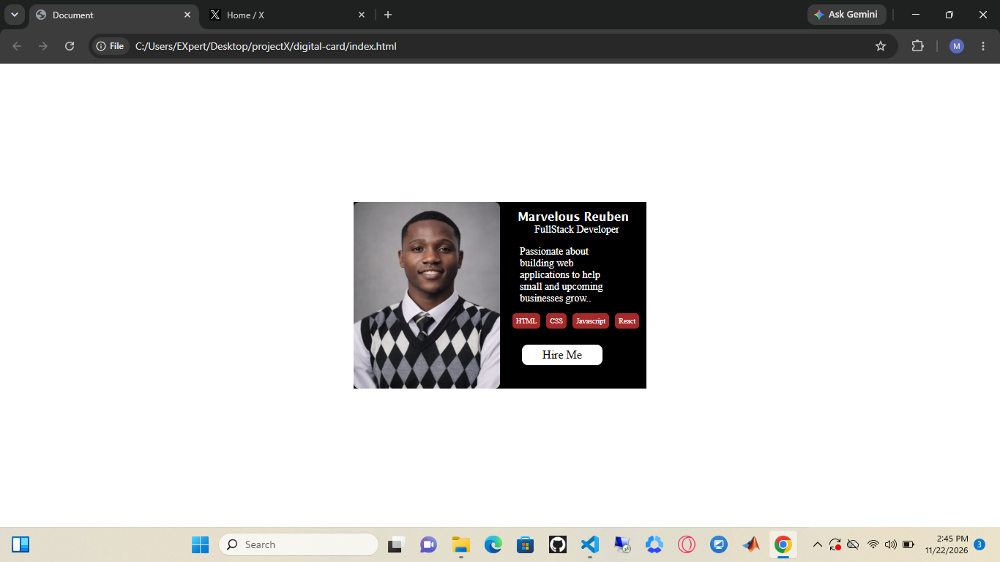

# Digital Profile Card

A compact, dark-themed digital business card built with plain **HTML** and **CSS**. It shows a profile photo, name, job title, a short bio, a list of skills, and a "Hire Me" call-to-action, all laid out with CSS Grid.



> Add a screenshot of your card at `assets/preview.png` so it shows up here.

## Features

- Fixed-size card (400 × 255px) centered on the page with Flexbox
- Two-column CSS Grid layout: photo on the left, details on the right
- Skill "tags" styled as rounded pills
- "Hire Me" button-style call-to-action
- No frameworks, no build step, no dependencies

## Tech Stack

- HTML5
- CSS3 (Grid and Flexbox)

## Project Structure

```
.
├── index.html
├── index.css
├── assets/
│   └── src/
│       └── profile.png
└── README.md
```

## Getting Started

1. **Clone the repository**
   ```bash
   git clone https://github.com/Marve2080/digital-card.git
   cd digital-card
   ```
2. **Open the card**
   Double-click `index.html`, or open it with a local server such as the VS Code Live Server extension.

That's it, there is nothing to install.

## Customization

| What to change | Where |
| --- | --- |
| Name, title, and bio | `index.html` (`.about` section) |
| Skills | The `<li>` items inside `.skills` in `index.html` |
| Profile photo | Replace `assets/src/profile.png` (keep the same filename or update the `src` in `index.html`) |
| Card size | `.container` `height` and `width` in `index.css` |
| Skill tag color | `.skills li` `background-color` in `index.css` |
| Card colors | `.container` `color` and `background-color` in `index.css` |

## Responsiveness

The card currently uses a fixed size. A commented-out media query at the bottom of `index.css` can be enabled to stack the layout vertically on screens narrower than 680px. Note that the fixed `height` and `width` on `.container` would also need adjusting for it to work well on small screens.

## Roadmap

- [ ] Make the card fully responsive
- [ ] Turn the "Hire Me" label into a real link (`mailto:` or a contact page)
- [ ] Add social links (GitHub, LinkedIn, X)
- [ ] Add hover effects and transitions

## Author

**Marvelous Reuben**, Full-Stack Developer

Passionate about building web applications that help small and upcoming businesses grow.

## License

This project is open source and available under the [MIT License](LICENSE).

